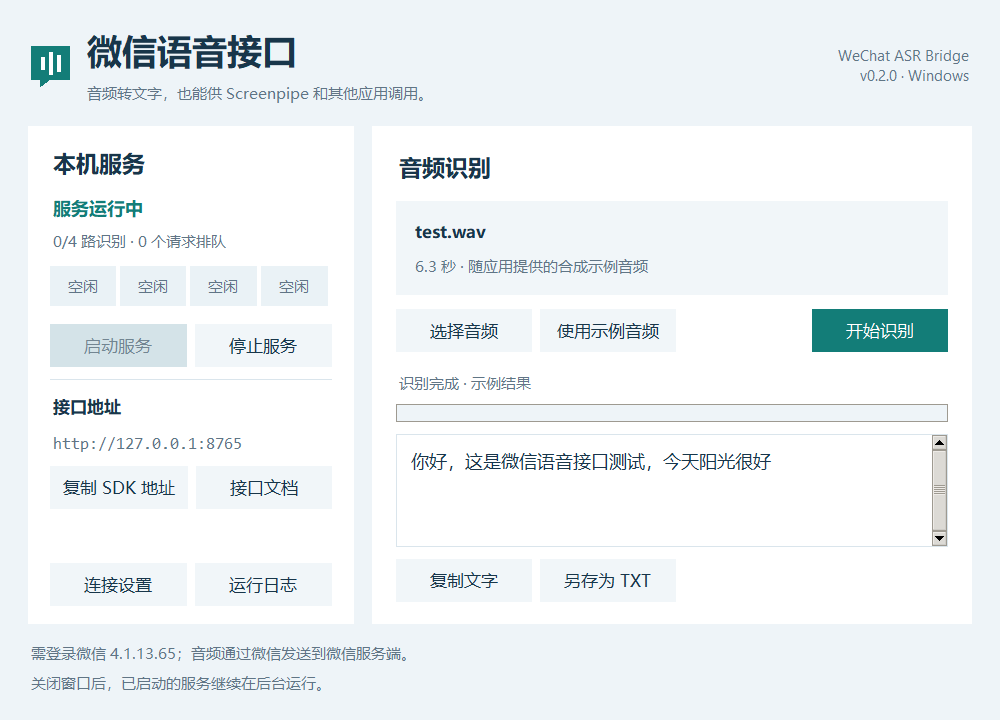

# WeChat ASR Bridge

把 Windows 微信聊天框的语音识别能力提供为可编程的 ASR（自动语音识别）接口。

支持 OpenAI Python SDK、WAV/MP3 输入、JSON/纯文本输出。识别请求由**已登录的微信客户端发送到微信的服务端**；音频不会发送到 OpenAI。`whisper-1` 是客户端兼容别名，后端实际使用微信。

[English](README.en.md) · [MIT License](LICENSE) · [协议与架构](docs/ARCHITECTURE.md)

## 免安装应用（推荐）

从 [Releases 下载 Windows 免安装窗口版](https://github.com/kuxiaowo/wechat-asr-bridge/releases/latest)，解压整个 ZIP，双击 `WeChatASRBridge.exe`。登录微信后点击「启动服务」，即可选择音频识别，或让 Screenpipe 调用本机接口。无需安装 Python、conda 或 FFmpeg。

应用支持服务状态、4 路并发、音频识别、复制/保存结果、连接设置和运行日志；关闭窗口后，接口服务继续在后台运行。详细步骤见 [窗口版使用说明](docs/PORTABLE.md)。



## 使用前确认

- Windows x64，推荐 Windows 10/11。
- 使用源码启动或开发时，需要 Miniconda/Anaconda 和 Python 3.11 x64；免安装应用不需要。
- 微信 **4.1.13.65**，登录后保留聊天主窗口。安装目录可以不同，程序自动定位实际加载的 DLL。
- 当前账号启用了微信语音输入的 iLink 与 Opus 配置。程序不修改开关。

目前仅对下面的 DLL 指纹验证过；微信升级后将拒绝原生调用，需要重新适配：

```text
8f7406a8a465e851ee10eaecccb572d0e5b4e00d480c770938c714c396097b74
```

这是版本限定的实验桥接器。原生插桩存在影响微信稳定性的可能，尚不能保证长期连续运行。项目与腾讯、微信、OpenAI 无隶属关系，不包含微信安装文件、登录密钥或聊天数据库。

## 从源码启动

在 Miniconda/Anaconda Prompt 或已能使用 `conda` 的 PowerShell 中：

```powershell
git clone https://github.com/kuxiaowo/wechat-asr-bridge.git
cd wechat-asr-bridge
powershell -NoProfile -ExecutionPolicy Bypass -File .\setup.ps1
```

手动登录微信，接着执行：

```powershell
.\env\python.exe .\doctor.py
powershell -NoProfile -ExecutionPolicy Bypass -File .\start.ps1
```

打开 [接口文档](http://127.0.0.1:8765/docs)，或在另一个终端验证：

```powershell
.\env\python.exe .\example_openai.py
```

正常会输出：“你好，这是微信语音接口测试，今天阳光很好”。示例音频在 `tests/fixtures/`，全部为专门合成的测试语音，不包含个人录音。

`doctor.py` 只检查环境、微信主进程和 DLL 指纹，不安装原生钩子，也不提交音频。诊断通过仍需用示例请求验证识别服务是否就绪。

## 配置客户端

| 配置项 | 值 |
|---|---|
| Base URL | `http://127.0.0.1:8765/v1` |
| API Key | 默认填 `wechat-local` |
| 模型 | `wechat-voice` 或 `whisper-1` |
| 请求 | `POST /v1/audio/transcriptions`，multipart 表单 |
| 模型列表 | `GET /v1/models` |
| 健康检查 | `GET /health`；不验证即时登录状态 |

```python
from openai import OpenAI

client = OpenAI(
    base_url="http://127.0.0.1:8765/v1",
    api_key="wechat-local",
    timeout=150,
    max_retries=0,
)
with open("audio.mp3", "rb") as audio:
    result = client.audio.transcriptions.create(
        model="whisper-1",
        file=audio,
        response_format="json",
    )
print(result.text)
```

成功响应：

```json
{"text":"你好，这是微信语音接口测试，今天阳光很好"}
```

`response_format="text"` 返回 UTF-8 纯文本。默认本机监听且未启用鉴权，API Key 仅满足 SDK 参数要求；可选启用鉴权：

```powershell
$env:WECHAT_API_KEY = 'your-local-secret'
powershell -NoProfile -ExecutionPolicy Bypass -File .\start.ps1
```

客户端必须使用同一密钥。默认只监听 `127.0.0.1`。通过 `server.py --host` 指定其他地址时必须设置 `WECHAT_API_KEY`。

## 后台启动和停止

```powershell
powershell -NoProfile -ExecutionPolicy Bypass -File .\start.ps1 -Background
powershell -NoProfile -ExecutionPolicy Bypass -File .\stop.ps1
```

停止命令会通知服务正常退出，让已经开始的请求完成并清理原生会话；不会直接强杀微信或服务进程。前台服务可按 Ctrl+C。

端口被占用时会提示，可以改为：

```powershell
powershell -NoProfile -ExecutionPolicy Bypass -File .\start.ps1 -Background -Port 8766
powershell -NoProfile -ExecutionPolicy Bypass -File .\stop.ps1 -Port 8766
```

客户端对应改为 `http://127.0.0.1:8766/v1`。日志和后台控制文件在 `.runtime/`，不会提交到 Git。

微信重启后程序会重新查找主进程。多个微信主窗口时可指定 `-WechatPid <PID>`，或设置 `WECHAT_PID` 环境变量；指定后需要在微信重启时更新 PID。

## 兼容范围与限制

- 不设置音频总时长上限，单文件最大 **25 MiB**。已实测 **75.3 秒 WAV/MP3**；原生 Opus 流按帧边界分包，在同一识别会话中递增包序号，仅最后一包标记结束。更长音频的微信服务端限制仍待验证。
- WAV/MP3 已验证，其他输入格式使用随 Python 依赖提供的 FFmpeg 解码；无需单独安装 FFmpeg。
- 支持 `json`/`text`。`stream=false`、`temperature=0` 可作为兼容默认参数传入；不控制微信识别模型温度。
- 暂不支持 `language`、`prompt`、流式输出、逐词时间戳、字幕或说话人分离。未实现参数返回 400，不会假装已经生效。
- 默认支持 **4 路并发识别**，超出的请求等待空闲槽位，不再因另一个请求正在识别而返回 429。各请求有独立原生会话、回调和清理过程；仍使用单个 Uvicorn worker，避免多个进程争用同一微信 agent。
- 微信不可用返回 503，识别超时返回 504，错误体为 OpenAI 风格的 `error` 对象。
- 上传音频和文本不会持久保存在项目中。multipart 解析可能使用请求结束后清理的系统临时文件；转换和转写缓冲在内存中处理。
- 仅实现音频转写与模型列表，不实现聊天、翻译、语音生成或 Realtime API。
- 同一微信进程复用常驻 Frida agent，每次调用创建并清理独立原生语音会话；服务停止时统一分离钩子和卸载脚本。清理状态不确定时暂停调用并保留 agent，需退出微信后重新登录。

## 常见问题

| 情况 | 处理 |
|---|---|
| 找不到 conda | 使用 Miniconda/Anaconda Prompt，或先安装 Miniconda |
| 无法执行 PowerShell 脚本 | 使用快速开始中的 `powershell -ExecutionPolicy Bypass -File ...`，只影响这次启动进程 |
| 微信升级 / DLL 指纹不符 | 暂停使用，等待该版本的地址和对象布局重新适配 |
| 503 / 无有效协程 | 确认微信已登录且聊天主窗口正常；部分账号可能未启用 iLink/Opus |
| 多个微信进程 | 自动发现只选择有聊天主窗口的主进程；必要时指定 PID，不要选择 OCR/播放器子进程 |
| 端口占用 | 停止原实例，或使用 `-Port 8766` |
| 请求排队 | 同时最多识别 4 个请求；客户端超时应包含排队时间 |
| 健康检查 ok 但转写失败 | `/health` 只表示桥接器状态，需查看错误响应和 `.runtime/` 日志 |

## 开发与验证

无需登录微信的 API 合约与音频检查：

```powershell
.\env\python.exe -m unittest discover -s tests -p "test_*.py" -v
```

已登录微信且服务运行时的真实 SDK 集成验证：

```powershell
.\env\python.exe .\tests\verify_live.py
# 其他端口：
.\env\python.exe .\tests\verify_live.py --base-url http://127.0.0.1:8766/v1
```

后者会把合成测试语音发送给微信识别服务，检查 WAV JSON、MP3 纯文本、SDK 错误解析，以及 2/4/8 个同时发起的请求是否全部成功、返回各自正确文本。8 请求会验证最多 4 路识别及其余请求排队。请在没有其他客户端请求的独立实例中运行。报告写入 `.runtime/api-verification.json`，不上传真实机器 PID、路径或运行日志。CI 在 Windows 上只跑无需微信的测试。

超过 35 秒的完整转写验证（使用仓库合成语音组成长音频，独立结尾从第 37.68 秒开始）：

```powershell
.\env\python.exe tests\verify_long.py
```

同时检查 WAV/MP3 的完整时长、结尾文字和会话清理，报告写入 `.runtime/long-verification.json`。移除限制与原生分包的调查记录见 [长音频验证](docs/LONG_AUDIO.md)。

连续调用和崩溃修复验证（必须只有一个服务实例连接微信）：

```powershell
.\env\python.exe tests\verify_stability.py --port 8765 --requests 20
```

该脚本检查每次转写结果及 `agent_generation` 是否保持一致，报告写入 `.runtime/stability-verification.json`。服务停止过程可用 `tests/verify_shutdown.py --port 8765` 验证，此命令会正常停止被测试的后台实例。

开发提交先进入 `developing` 分支，再通过 PR 合并到 `main`。

构建免安装窗口版：

```powershell
powershell -NoProfile -ExecutionPolicy Bypass -File .\build.ps1
```

输出为 `dist/WeChatASRBridge-0.2.0-windows-x64-portable.zip` 和 `SHA256SUMS.txt`。构建使用 PyInstaller 文件夹模式，将窗口、API 服务、原生 agent 和 FFmpeg 打包在一起；不会包含微信程序、账号数据或 `.runtime/`。GitHub Actions 的 `Windows portable release` 工作流也可构建并上传 ZIP。

协议格式参考：[OpenAI 官方 Create transcription 文档](https://developers.openai.com/api/reference/resources/audio/subresources/transcriptions/methods/create)。项目代码采用 [MIT](LICENSE) 许可；第三方依赖和微信客户端保留各自的许可证及条款。
